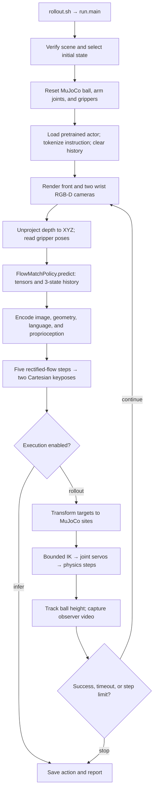

# 3DFA checkpoint inference in MuJoCo

The rollout calls inference in [run.main(), run.py](run.py):

```python
action = policy.predict(rgb, points, state)
```

The actual pretrained PyTorch actor is called inside
[FlowMatchPolicy.predict(), policy.py:137](policy.py#L137):

```python
action = self.actor(
    None, mask, rgb_t, None, pcd_t, self.tokens, proprio,
    run_inference=True,
)[0, 0].cpu().numpy()
```

This returns one absolute Cartesian target for each arm. The controller then
executes those targets in MuJoCo. The following trace describes the current
implementation; source links include line anchors and function names.

## Run this pipeline

From `/home/aks-lab/3dfa/3d_flowmatch_actor`:

```bash
# CUDA inference, randomized source start, four synchronized video angles.
PYTHONPATH= bash scripts/mujoco/rollout.sh \
  --observation-renderer source_mujoco \
  --randomize --reset-seed 42 --steps 25 --video-view all
```

[rollout.sh](../scripts/mujoco/rollout.sh) launches `.venv/bin/python -m
mujoco_transfer.run --mode rollout --device cuda` with the prepared scene
and reference configuration. `--steps 25` limits policy keypose predictions;
each prediction can require many physics steps.

To inspect a prediction without executing it:

```bash
PYTHONPATH= .venv/bin/python -m mujoco_transfer.run \
  --mode infer --device cuda --episode 8 --observation-renderer source_mujoco
```

`observe` saves camera inputs and state without loading the actor.
`infer` additionally predicts one action.
`rollout` repeatedly predicts and executes actions, recording video by default.

## Data flow



The three policy cameras supply model inputs. The four observer views in
`rollout.mp4` visualize the simulation independently.

## Code map

| Stage | Entry point | What it does |
|---|---|---|
| Launch | [scripts/mujoco/rollout.sh](../scripts/mujoco/rollout.sh) | Selects the local Python environment, CUDA, prepared scene, and config. |
| Orchestration | [run.main(), run.py:16](run.py#L16) | Parses options, verifies settings, creates the environment and policy, and manages the loop. |
| Scene verification | [verify_settings.py:119](verify_settings.py#L119) | Checks source bases, ball geometry, prepared start, and success threshold. |
| Source reset selection | [SourceEpisodeSampler.sample(), initial_states.py:127](initial_states.py#L127) | Selects one complete recorded initial state. |
| Reset application | [PandaBallEnvironment.reset(), environment.py:221](environment.py#L221) | Sets ball pose, both joint configurations, and matching actuator targets. |
| Checkpoint loading | [load_actor(), policy.py:51](policy.py#L51) | Builds the matching architecture, loads weights strictly, and moves the actor to the requested device. |
| Instruction/history reset | [FlowMatchPolicy.reset(), policy.py:112](policy.py#L112) | Tokenizes the instruction and clears observation history. |
| Observation | [ObservationAdapter.observe(), environment.py:69](environment.py#L69) | Renders RGB and metric depth, reconstructs XYZ, and returns gripper state. |
| Source appearance, MuJoCo only | [SourceVisualObservationRenderer.observe()](source_visual_renderer.py) | Synchronizes exported source visual assets to actual physical state and renders matching RGB/XYZ. |
| Native appearance bridge | [NativeObservationRenderer.observe()](native_renderer.py) | Renders actual physical state in an isolated source-simulator worker, without stepping source physics. |
| Inference adapter | [FlowMatchPolicy.predict(), policy.py:121](policy.py#L121) | Builds batched tensors and calls the pretrained actor. |
| Model inference branch | [DenoiseActor.forward(), base_denoise_actor.py:317](../modeling/policy/base_denoise_actor.py#L317) | Dispatches `run_inference=True` to `compute_trajectory()`. |
| Flow sampling | [compute_trajectory(), base_denoise_actor.py:148](../modeling/policy/base_denoise_actor.py#L148) | Encodes observations, samples a latent action, and produces the final keyposes. |
| Action frame conversion | [ObservationAdapter.action_to_sites(), environment.py:96](environment.py#L96) | Converts policy gripper targets into MuJoCo site targets. |
| Physical execution | [CartesianController.execute(), environment.py:183](environment.py#L183) | Uses bounded IK and position servos, then applies the gripper commands. |
| Success | [PandaBallEnvironment.track_success(), environment.py:261](environment.py#L261) | Records whether ball centre height reaches 0.95 m. |
| Video | [RolloutVideo.capture(), video.py:128](video.py#L128) | Renders synchronized observer panels and writes frames to ffmpeg. |

## 1. Scene and initial state

The default files are:

- Scene: [`runtime/panda_ball_reference/scene.xml`](../runtime/panda_ball_reference/scene.xml).
- Configuration: [`runtime/panda_ball_reference/reference_config.json`](../runtime/panda_ball_reference/reference_config.json).
- Native source settings: [`configs/peract2_scene.json`](configs/peract2_scene.json).
- Released demonstration metadata: `runtime/peract2_test.zip`.

Preparation is separate from inference. [prepare.py](prepare.py) exports the
Panda branch assets and adds actuators, finger sliders, and cameras.
[reference.calibrate_reference()](reference.py#L114) applies the source base
poses, ball settings, camera calibration, and fitted TCP corrections.

At run time, [run.main()](run.py) checks the prepared scene. For randomized
starts, it creates `SourceEpisodeSampler`; the environment
applies the selected start, and [verify_initial_state()](verify_settings.py#L167)
checks the resulting ball pose, joint positions, grippers, actuator commands,
zero velocities, and simulation time.

| Option | Initial state |
|---|---|
| Neither reset option | Prepared calibration start, currently source episode 3. |
| `--randomize` | Uniform selection with replacement from 100 released ball-task starts. |
| `--randomize --reset-seed 42` | Reproducible selection; the first draw is episode 8. |
| `--episode 8` | Explicitly select episode 8. |

The reset sampler verifies the archive hash and keeps each ball pose paired
with that episode's two joint configurations. It uses its own RNG.
`--seed` controls policy sampling; `--reset-seed` controls episode selection.
Without a reset seed, a fresh seed is generated and recorded.

The source task has randomized ball placement and yaw. Its arm homes and
bases are fixed; recorded homes have small settling differences. This mode
samples recorded evaluation starts, not new continuous RLBench placements.
Reset does not execute the source demonstration's later actions.

## 2. Load the pretrained policy

[PERACT2_MODEL](policy.py#L13) configures the architecture for
`checkpoints/3dfa_peract2.pth`: CLIP encoders, embedding dimension 120,
8 attention heads, 3 vision-language layers, 4 shared decoder layers,
3 history states, 2 hands, absolute actions, and 5 rectified-flow steps.

[load_actor()](policy.py#L51) instantiates the 3D
[DenoiseActor](../modeling/policy/denoise_actor_3d.py#L10), removes only 34
legacy normalization tensors unused by the released implementation, and
strictly loads the remaining 835 tensors. Frozen backbone weights are
included in the checkpoint. The actor is put in evaluation mode, and
`predict()` uses `torch.inference_mode()`.

The rollout records the checkpoint SHA256 and whether it matches the known
release. The download helper enforces that hash; passing a different checkpoint
to the runner records its identity and still requires compatible weights.

No optimizer, backward pass, or weight update runs in this inference path.

## 3. Build observations

The loop calls `observation_renderer.observe()`. Select `source_mujoco` for
source appearance rendered entirely with MuJoCo, or `source_native` for the
live native rendering bridge. Both use the current physical ball pose and
actual TCPs on every policy step; no subsequent demonstration observations or
actions enter the loop. Physical control and checkpoint inference are shared.
See [RENDERING_TRANSFER.md](RENDERING_TRANSFER.md) for the tested pipeline and
the distinction between the physical robot and synchronized visual model.

The retained `mujoco` baseline calls
[ObservationAdapter.observe()](environment.py#L69), which renders cameras in this order:
`front`, `wrist_left`, `wrist_right`, each at 256×256.
It unprojects metric depth using
[depth_to_world()](geometry.py#L40), then applies `T_policy_from_mujoco`.
The prepared source scene currently uses an identity world transform.

[ObservationAdapter.state()](environment.py#L59) reads the two end-effector
sites, applies the fitted TCP transforms, and computes normalized finger
opening. Arm order is always `left`, then `right`.

| Value | Adapter shape | Model input shape / convention |
|---|---|---|
| RGB | `(3, 256, 256, 3)` uint8 | `(1, 3, 3, 256, 256)` float, divided by 255 |
| Dense XYZ | `(3, 256, 256, 3)` float | `(1, 3, 3, 256, 256)`, metres in policy world frame |
| Current gripper state | `(2, 8)` | Each row: `x, y, z, qx, qy, qz, qw, openness` |
| Gripper history | `(3, 2, 8)` | `(1, 3, 2, 8)`, oldest to newest |
| Instruction tokens | — | `(1, token_count)`, CLIP tokens for `"Lift the ball"` |
| Trajectory mask | — | `(1, 1, 2)`, one requested keypose for each of two arms |

[PoseHistory.append()](policy.py#L92) repeats the initial state to fill the
three history slots. Subsequent slots contain states at policy calls, not
every physics tick. CLIP mean/std normalization happens inside the model
after the adapter's `/255`.

Joint angles determine simulated site poses but are not passed directly as
the model's proprioception tensor. Ground-truth ball position is used for
reset and task checks; the policy receives rendered geometry and images.

## 4. Run the network and flow sampler

The call chain is:

```text
run.main()
  policy.predict(rgb, points, state)
    self.actor(..., run_inference=True)
      DenoiseActor.forward()             # inherited from base_denoise_actor.py
        compute_trajectory()
          encode_inputs()               # once per predicted action
          conditional_sample()          # five decoder/scheduler iterations
            policy_forward_pass()
            position_scheduler.step()
            rotation_scheduler.step()
          unconvert_rot()
          unnormalize_pos()
          sigmoid(openness)
```

The [3D encoder](../modeling/encoder/multimodal/encoder3d.py#L90) combines CLIP
image/text features with aligned 3D positions. History is flattened to six
arm/history entries; the released proprioception encoder uses their XYZ
positions for attention. Encoded context is reused for all five flow steps
within that action.

[compute_trajectory()](../modeling/policy/base_denoise_actor.py#L148) initializes
Gaussian noise of shape `(1, 1, 2, 9)`: normalized XYZ plus a 6D rotation
representation. [conditional_sample()](../modeling/policy/base_denoise_actor.py#L122)
runs five updates. The [rectified-flow scheduler](../modeling/noise_scheduler/rectified_flow.py#L15)
uses times `1.0, 0.8, 0.6, 0.4, 0.2`, ending at zero:

```text
next_sample = current_sample - (t - next_t) * predicted_velocity
```

Position and rotation use separate scheduler updates. The final decoder's
openness logit is appended to the sampled pose, then passed through sigmoid.
Rotation is converted from 6D to a matrix and then to quaternion XYZW.
XYZ is converted back to metres using the checkpoint's unchanged workspace
normalizer. Input point clouds remain in metric world coordinates.

The model returns `(1, 1, 2, 8)`. The adapter selects `[0, 0]` to return:

```text
action[0] = left  [x, y, z, qx, qy, qz, qw, open_probability]
action[1] = right [x, y, z, qx, qy, qz, qw, open_probability]
```

These are absolute gripper keyposes. The bridge requests one keypose per arm
per model call; it does not execute a long predicted trajectory.

For repeated evaluation across reset seeds 0–100, the
[batch runner](SEED_SWEEP.md) invokes this same pipeline once per seed and
aggregates the resulting reports.

## 5. Execute the predicted keyposes

[run.main()](run.py) calls:

```python
entry["controller"] = env.controller.execute(action, callback)
```

The adapter converts each predicted gripper pose into the corresponding
MuJoCo end-effector site pose:

```text
T_mujoco_site_target =
    inverse(T_policy_from_mujoco)
    @ T_policy_gripper_target
    @ inverse(T_site_from_policy_gripper)
```

[CartesianController.tick()](environment.py#L152) computes site Jacobians,
solves bounded damped least squares with joint limits, updates actuator
position targets, and advances `mujoco.mj_step()`.

The current reference config uses a 20 ms controller period and a 2 ms
physics step: ten physics steps per controller tick. A keypose has an 8 s
timeout, with 1 cm position and 0.1 rad orientation tolerances.
Once both arms reach their targets, openness is thresholded at 0.5 and the
grippers are controlled for another 0.4 s while the arms hold their targets.

The next policy observation is captured after action execution. This controller
uses local IK; it does not perform obstacle-aware path planning.

## 6. Success checks, video, and saved evidence

During execution, the callback checks whether ball centre world height reaches
`0.95 m`, captures video frames, and synchronizes the optional live viewer.
The success flag records whether the threshold has been reached. The outer
loop stops after the controller returns on success, controller timeout,
viewer closure, or the policy-step limit.

This adapter latches a threshold crossing during the action, even if the ball
falls before the action finishes. Check the final `steps[-1].ball_height_m`
as well as `task_success`; crossing the threshold alone does not establish
sustained holding. The renderer pilot's two measurements are reported in
[RENDERING_TRANSFER.md](RENDERING_TRANSFER.md).

Each output folder contains:

| Artifact | Meaning |
|---|---|
| `observation_000.npz`, etc. | Actual RGB, point clouds, current gripper state, and MuJoCo `qpos` before each prediction. |
| `cameras_000.png`, etc. | The three images supplied to the policy, side by side. |
| `report.json` | Configuration, checkpoint identity, selected reset, verification, predicted actions, controller errors, timings, and outcome. |
| `rollout.mp4` | Observer video; default `all` shows four synchronized views at 1280×960. |

The report's `steps[i].action_policy_frame` is the raw `(2,8)` prediction.
`steps[i].controller` records whether the physical controller reached it.
`task_success` reports the task result; successful checkpoint loading alone
does not establish task success.

Existing examples:
[episode 8 video](../runtime/video-randomized-seed42/rollout.mp4) and
[report](../runtime/video-randomized-seed42/report.json);
[episode 94 video](../runtime/video-randomized-seed7/rollout.mp4) and
[report](../runtime/video-randomized-seed7/report.json).
Both runs passed reset verification and failed to lift the ball.

## Current transfer limits

The source settings and recorded resets are verified, while the branch's
internal arm geometry still differs from the source robot. TCP fitting leaves
approximately 14.75 mm and 17.87 mm position RMS residuals for the two arms;
wrist-camera alignment remains approximate. The branch's collision masks
also disable ball–floor contacts, so a ball pushed off the table continues
falling. See the [setup and validation guide](README.md) for details.

The existing 43-test suite covers checkpoint parity, RGB-D geometry,
controller behavior, source settings, and randomized resets. This document
traces that implementation; no model or controller behavior is changed by it.
