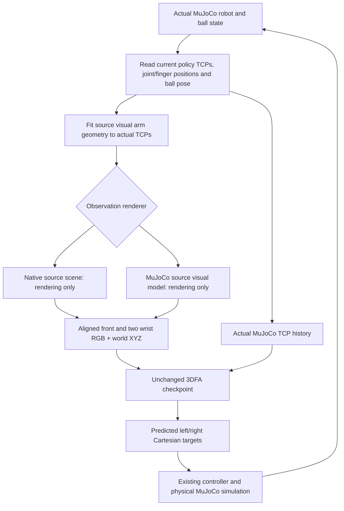

# Pretrained inference with source appearance

Both observation paths use the unchanged released checkpoint and the existing
physical Panda scene, Cartesian controller, contacts and source success
condition. Each prediction uses the current executed MuJoCo state. The source
demonstration supplies only the initial reset and fixed camera calibration;
its later observations or expert actions are never fed to the policy.

| Mode | Policy camera renderer | Runtime dependency |
|---|---|---|
| `mujoco` | Original branch visuals | MuJoCo; retained baseline |
| `source_native` | Original source scene synchronized to MuJoCo | CoppeliaSim/PyRep worker and a working X display |
| `source_mujoco` | Exported source visual assets synchronized to MuJoCo | **MuJoCo only** after the one-time export |

Use `source_mujoco` for the prepared MuJoCo-only inference path. The default
remains `mujoco` so old commands retain their original meaning; select the new
mode explicitly.

## Run inference and save four-view video

From `/home/aks-lab/3dfa/3d_flowmatch_actor`:

```bash
PYTHONPATH= bash scripts/mujoco/rollout.sh \
  --observation-renderer source_mujoco \
  --episode 94 --seed 0 --steps 25 --video-view all
```

For a randomized source start, replace `--episode 94` with
`--randomize --reset-seed 42`. Omit `--reset-seed` for a fresh source selection.
For the native rendering bridge, use `--observation-renderer source_native`.
All rollouts save `rollout.mp4`, policy camera PNGs, observation NPZs and
`report.json` under the printed output directory. `--output` selects a new
named directory. Four-view video depicts the actual physical MuJoCo robot;
the camera PNGs show what the checkpoint sees.

Videos and the live viewer show a translucent light grey 20 cm goal cube.
Its center is at the initial ball X/Y and the source goal height, z=0.95 m.
The task constrains height only; the cube is a visual reference, not a target
volume. It is absent from policy cameras and has no physical collisions.

The visual model uses source robot geometry to reproduce the checkpoint's
observations. It is a separate model synchronized to the actual physical
robot's TCPs and finger positions. This is not a claim that ordinary images
of the original branch model now work, or that the method can use arbitrary
real-camera images without adaptation. Ball poses come directly from the
simulator state.

## One-time preparation

Assets are already prepared on this machine at `runtime/source_visuals/`.
To reproduce the export with the existing source-audit CoppeliaSim/PyRep
installation:

```bash
bash scripts/mujoco/prepare_visuals.sh
```

This verifies/downloads the pinned source scene files to
`runtime/source-audit/RLBench/`, extracts meshes, normals, UV coordinates,
textures, materials, lights and the articulated hierarchy, and checks its
forward kinematics against native simulator captures. The three source files
are SHA-256 checked against the authored scene fixture. The export retains
source hashes, parameters and independent perturbed-posture captures in
`runtime/source_visuals/manifest.json`.

CoppeliaSim is needed for that export and for `source_native` observations.
It is not imported or launched by `source_mujoco` inference. That path consumes
only the exported JSON, OBJ and PNG assets. `--source-visual-assets` can select
a different exported directory. The native path also accepts
`--source-scene-root` and `--coppeliasim-root`.

## State and inference pipeline



The source and branch robot chains differ. Copying joint coordinates alone
would misplace the rendered hands and wrist cameras. Both new modes use
bounded source-arm IK, seeded with the current physical joint coordinates,
to align the rendered source TCPs to the actual policy TCP poses. The cameras
use the source's fixed mounts relative to those TCPs. Alignment residuals and
any failure to meet the 2 mm / 0.02 rad alignment tolerances are recorded; this
solver is only for visualization and never commands the physical robot.

The native scene is never stepped. The MuJoCo visual model calls `mj_forward`
but never `mj_step`. RGB and XYZ come from the same renderer and scene state;
the mixed RGB/XYZ interventions from the earlier diagnosis are not used here.
The physical environment alone determines contacts, motion and task success.

| Code | Responsibility |
|---|---|
| [run.py](run.py) | Selects the renderer and runs `policy.predict(rgb, points, state)` followed by physical execution |
| [source_kinematics.py](source_kinematics.py) | Source FK/IK and fixed camera calibration |
| [native_renderer.py](native_renderer.py), [native_worker.py](native_worker.py) | Isolated Qt process, current-state requests, source rendering and alignment logs |
| [source_visual_renderer.py](source_visual_renderer.py) | Builds and synchronizes the separate MuJoCo visual model |
| [export_source_visuals.py](../scripts/mujoco/export_source_visuals.py) | One-time native visual export and kinematic checks |
| [policy.py](policy.py) | Original checkpoint loading, history and actual actor inference; unchanged |
| [environment.py](environment.py) | Original physical scene adapter, controller and success condition; unchanged |

MuJoCo lighting and texture filtering are not pixel-identical to the native
OpenGL renderer. The exporter/scene builder handles native opacity flags and
wireframe-only helper objects; filling those helpers would falsely occlude
the table. Actual room geometry supplies both RGB and depth, without an added
skybox that can disagree with the depth pass.

## Evaluate distinct starting states

```bash
PYTHONPATH= MUJOCO_GL=egl HF_HOME="$PWD/runtime/huggingface" \
  OMP_NUM_THREADS=4 .venv/bin/python scripts/mujoco/evaluate_renderers.py \
  --renderers source_native source_mujoco \
  --output runtime/rendering_transfer/my_comparison
```

The default fixed episode set is `3, 8, 87, 94, 85, 72, 12, 26, 48, 63`,
with policy seed 0 and up to 25 predictions. These are ten distinct source
episode IDs, not reset-seed samples with replacement. Both modes use the same
resets and policy seed. Each child saves its own four-view video and reports;
the parent writes `summary.json` and per-episode logs. Pass `--episodes` to
select another distinct set. Use a new output directory for each evaluation.

The previously requested seeds 0–100 pipeline also accepts the new modes:

```bash
PYTHONPATH= bash scripts/mujoco/sweep.sh \
  --observation-renderer source_mujoco \
  --output runtime/seed_sweeps/source_visuals_000_100
```

Add `--resume` with the same arguments to resume this batch. Its fingerprint
includes the selected renderer, implementation, manifest, meshes and textures.
The original `runtime/seed_sweeps/seeds_000_100/` results are preserved.

## Validation and evidence

Both modes reached the source lift-height condition on **10/10 episodes**
in the distinct episode set above, with four policy predictions per run and
no execution errors. Some runs then dropped the ball before the final action
finished:

| Renderer | Reached source goal height | Still above goal at final action end |
|---|---:|---:|
| `source_native` | 10/10 | 7/10 |
| `source_mujoco` | 10/10 | 5/10 |

All twenty four-view videos were saved. The original branch-camera
101-reset-seed sweep is unchanged; this is a separate pilot, not a replacement
result for that full sweep. Reliable sustained holding remains unproven.

The source height condition is ball-centre `z >= 0.95 m`. The existing MuJoCo
adapter latches any crossing during execution. Reports additionally
record maximum height and longest continuous time above the goal during
executed actions. That duration is diagnostic; no extra holding phase or
changed success criterion is introduced. The longest continuous intervals
above the goal ranged from 1.024–6.912 s for `source_native` and
0.858–4.976 s for `source_mujoco`. Final height is measured when the controller
returns from its last action, rather than after an additional stability test.

Termination timing differs: the [source Cartesian planner](https://github.com/markusgrotz/RLBench/blob/8af748c51287989294e00c9c670e3330a0e35ed5/rlbench/action_modes/arm_action_modes.py#L453-L467)
checks success each simulation step and stops its path as soon as the condition
is met. The current MuJoCo controller continues to its requested target and
gripper phase, then returns. These results establish source-height crossings,
not identical source benchmark termination or sustained holding. Controller
termination was preserved while changing the observation renderers.

The initial evaluations are saved here:

- [Native bridge summary](../runtime/rendering_transfer/native_eval_10_v1/summary.json).
- [MuJoCo-only summary](../runtime/rendering_transfer/mujoco_eval_10_v1/summary.json).
- [Native bridge episode 94 video](../runtime/rendering_transfer/native_eval_10_v1/source_native/episode_094/rollout.mp4).
- [MuJoCo-only episode 94 video](../runtime/rendering_transfer/mujoco_eval_10_v1/source_mujoco/episode_094/rollout.mp4).
- [Three-way camera comparison](../runtime/rendering_transfer/camera_comparison_episode094.png).
- [Independent artifact validation, including final heights](../runtime/rendering_transfer/validation.json).

The artifact audit verified all twenty videos and reconstructed all eighty
saved observations from their physical joint states. Returned proprioception
matched the actual MuJoCo state, rendered ball poses matched the physical ball,
and all source visual TCPs met the alignment tolerances. Hashes confirmed the
physical scene, configuration, environment/controller and checkpoint adapter
were unchanged throughout the comparison.

These are full policy rollouts, separate from the expert replays in
[DIAGNOSIS.md](DIAGNOSIS.md). No fine-tuning or controller/physics changes were
made. A ten-episode pilot does not establish performance across all source
starts, other policy noise seeds or other tasks; the larger sweep above is
prepared for that evaluation.

```bash
PYTHONPATH= PYTEST_DISABLE_PLUGIN_AUTOLOAD=1 MUJOCO_GL=egl \
  TEST_SOURCE_RENDER=1 TEST_NATIVE_RENDER=1 OMP_NUM_THREADS=4 \
  .venv/bin/python -m pytest -q tests/test_observation_renderers.py \
  tests/test_source_kinematics.py tests/test_source_visual_renderer.py
```

The real-renderer tests check that observing does not modify physical state,
that new physical ball/arm poses change the observations, that returned
proprioception is the actual physical state, and that source TCP alignment
and metric point clouds remain consistent. Independent native captures
validate the entire exported hierarchy at three postures.

The complete suite passed **92 tests**, including the actual checkpoint and
both renderers, with:

```bash
PYTHONPATH= PYTEST_DISABLE_PLUGIN_AUTOLOAD=1 MUJOCO_GL=egl \
  HF_HOME="$PWD/runtime/huggingface" TEST_SOURCE_RENDER=1 TEST_NATIVE_RENDER=1 \
  TEST_RENDER=1 TEST_CHECKPOINT=1 OMP_NUM_THREADS=4 \
  .venv/bin/python -m pytest -q tests
```
