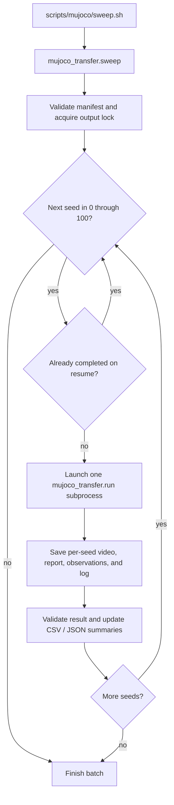

# Run reset seeds 0–100

This batch executes **101 rollouts**, including both endpoints, using the
prepared Panda ball task and pretrained CUDA policy. Each run samples a
released source initial state with its reset seed and records a four-angle
video. Runs execute sequentially on one GPU.

## Use the corrected observations

The source-appearance mode is explicitly selected with
`--observation-renderer source_mujoco`. All ten pilot episodes crossed the
source goal height; five still exceeded it at the final action's end.
The existing `task_success` flag records any crossing during execution, so
also inspect final heights when assessing stable lifting. The full 101-seed
sweep is prepared for you to run:

```bash
cd /home/aks-lab/3dfa/3d_flowmatch_actor
PYTHONPATH= bash scripts/mujoco/sweep.sh \
  --observation-renderer source_mujoco \
  --output runtime/seed_sweeps/source_visuals_000_100
```

Use the same arguments plus `--resume` when resuming. The original result
directory is preserved. Omitting the renderer option retains the original
branch-camera baseline; the commands below describe that backward-compatible
default. Both modes use identical physical reset randomization, checkpoint
and controller. Renderer assets are included in the resume fingerprint.

## Start the batch

```bash
cd /home/aks-lab/3dfa/3d_flowmatch_actor
PYTHONPATH= bash scripts/mujoco/sweep.sh
```

Defaults:

| Setting | Value |
|---|---|
| Reset seeds | `0, 1, ..., 100` |
| Policy sampling seed | `0` for every run |
| Policy keypose limit | `25` per run |
| Device | `cuda` |
| Video views | `all`: overview, opposite, side, top |
| Output | `runtime/seed_sweeps/seeds_000_100/` |

These are reset seeds, not source episode IDs. Multiple seeds can select the
same source episode. The summary records the selected episodes and coverage.
The source population contains 100 recorded initial states; robot bases stay
fixed and no additional joint noise is introduced.

To vary both the reset seed and policy sampling seed together:

```bash
PYTHONPATH= bash scripts/mujoco/sweep.sh \
  --policy-seed match --output runtime/seed_sweeps/both_seeds_000_100
```

To choose a smaller interval or a different output location:

```bash
PYTHONPATH= bash scripts/mujoco/sweep.sh \
  --start-seed 0 --end-seed 9 --steps 25 \
  --output runtime/seed_sweeps/seeds_000_009
```

## Preview without inference

```bash
PYTHONPATH= bash scripts/mujoco/sweep.sh --dry-run
```

This prints the planned per-seed commands. It does not launch inference or
create output files. The equivalent command for reset seed 42 is:

```bash
.venv/bin/python -u -m mujoco_transfer.run \
  --mode rollout --device cuda \
  --scene runtime/panda_ball_reference/scene.xml \
  --config runtime/panda_ball_reference/reference_config.json \
  --checkpoint checkpoints/3dfa_peract2.pth \
  --reference-archive runtime/peract2_test.zip \
  --randomize --reset-seed 42 --seed 0 \
  --steps 25 --video-view all --threads 4 \
  --output runtime/seed_sweeps/seeds_000_100/seed_042/attempt_001
```

## Resume and retry

After interruption, use the same arguments plus `--resume`:

```bash
PYTHONPATH= bash scripts/mujoco/sweep.sh --resume
```

Completed rollouts are skipped, including completed task failures such as a
controller timeout. A task failure is still an evaluated seed.
Interrupted or incomplete attempts are preserved when a new attempt is made.

To retry execution errors as well:

```bash
PYTHONPATH= bash scripts/mujoco/sweep.sh --resume --retry-errors
```

Each retry uses a new attempt directory. Existing videos, reports, and logs
are retained. Resume checks that the batch configuration and input files
match its saved manifest; use a new output directory for a changed experiment.
Only one batch process may write to a given output directory at a time.

`Ctrl+C` stops the active child run and the batch. Use `--resume` to continue.
The exit code is `0` when all seeds have valid evaluated results (including
task failures), `1` when execution errors remain, `2` for a setup/manifest
error, or `130` after interruption.

## Files and results

```text
runtime/seed_sweeps/seeds_000_100/
├── manifest.json
├── summary.csv
├── summary.json
├── seed_000/
│   ├── attempt_001.log
│   ├── attempt_001.status.json
│   └── attempt_001/
│       ├── rollout.mp4
│       ├── report.json
│       ├── cameras_000.png
│       └── observation_000.npz
├── seed_001/
│   └── ...
└── seed_100/
    └── ...
```

Per-seed logs contain the child process's console output. The batch console
shows progress. Summaries are updated as runs finish, so partial results can
be inspected before all 101 seeds complete.

The summary separates:

- **Task success:** the run completed and reached the source height condition.
- **Completed task failure:** the run completed but timed out or hit its step limit.
- **Execution error:** the process failed, the report was invalid, or required
  output was incomplete.
- **Pending:** the seed has not completed an evaluable run.

The task success rate uses completed valid runs as its denominator.
Execution errors are reported separately and are not silently counted as
evaluated task failures. The summary records reset/policy seeds, source
episode, stop reason, prediction count, inference timing, final reported
ball height, and paths to the report, video, and log.

The existing single-run transfer limitations still apply: matching source
initial states does not establish successful ball lifting. Read individual
reports and videos alongside the aggregate rate.

## Code pipeline



[sweep.sh](../scripts/mujoco/sweep.sh) launches
[sweep.py](sweep.py), which invokes the existing [run.py](run.py) pipeline
once per seed. The model and simulator are loaded in each child process.
See [INFERENCE_PIPELINE.md](INFERENCE_PIPELINE.md) for the prediction,
controller, and camera code inside each run.

## Validation of the batch runner

The 101-command dry run and 36 orchestration tests passed. Tests use simulated
child processes to exercise summaries, resume/retry, interruption, and invalid
artifacts; they do not launch CUDA inference:

```bash
PYTHONPATH= PYTEST_DISABLE_PLUGIN_AUTOLOAD=1 \
  .venv/bin/python -m pytest -q tests/test_seed_sweep.py
```

The real 101-seed evaluation is left for you to launch with the command above.
